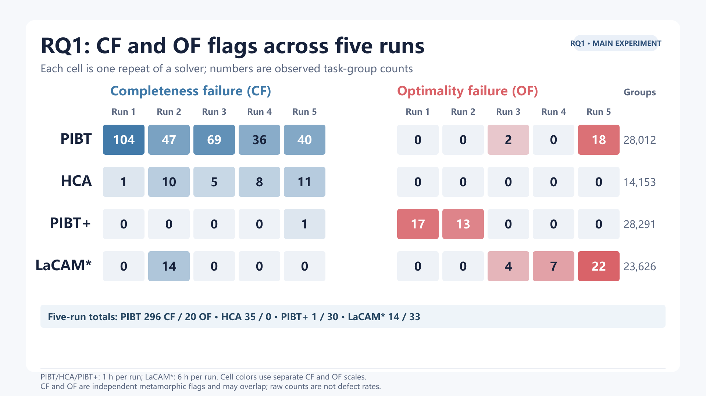
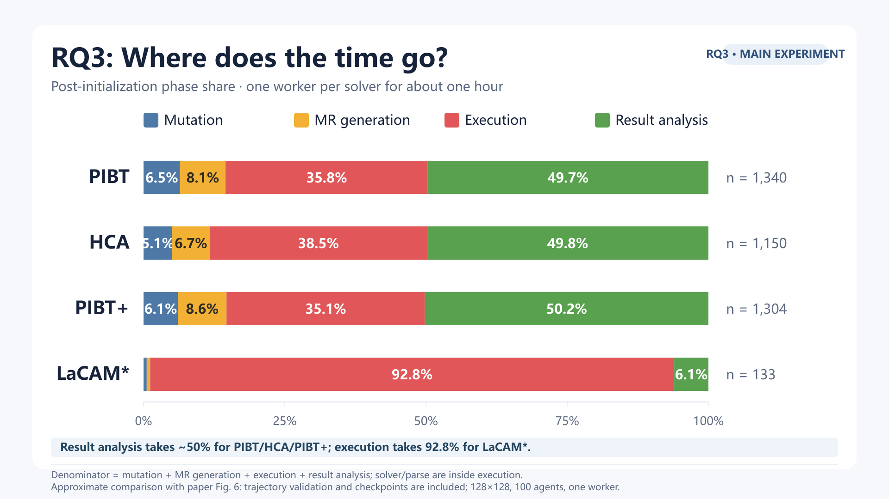

# MAPF-Fuzz Reproduction

An independent, course-scale reproduction of **MAPF-Fuzz: Metamorphic Fuzzing for Multi-Agent Path Finding Algorithms** (ICSE 2026). This repository implements the testing pipeline and reports results for **RQ1 (failure discovery)** and **RQ3 (time breakdown)** on PIBT, HCA, PIBT+, and LaCAM*. The focus is on what the reproduced experiments reveal; RQ2 and RQ4 are outside this course project.

The [paper](https://doi.org/10.1145/3744916.3787841) and [authors' implementation](https://github.com/shepera/MAPF-Fuzz) are the references. The Python testing pipeline in [reproduce/](reproduce/) is our own implementation. Solver source code is obtained through pinned upstream Git submodules; the maps and reference defect examples originate from the authors' public materials.

## Reproduction workflow

1. **Build the solvers and prepare seeds.** Pin and compile the PIBT2 and LaCAM3 submodules. Resize each of the 30 source maps to 128 × 128 and generate up to three valid 100-agent scenarios per map. Check unique starts and goals, traversable endpoints, and individual start-to-goal connectivity.
2. **Select and mutate a seed.** Extract a 16-dimensional feature vector and trajectory-based criticality scores. Use novelty, metamorphic disparity, and criticality to select a parent. Mutate high-use map regions with noise, cellular automata, or diffusion-limited aggregation, and/or change agent starts and goals with unguided or trajectory-guided operations. Filter invalid scenarios before execution.
3. **Generate metamorphic follow-up tasks.** For each task, reorder agents, mirror or rotate the map and agents, and swap all start/goal pairs. When the original task has a solution, also add short probe agents or off-path obstacles. The swap relation tests solvability; the other six relations contribute to the paper-style sum-of-costs (SOC) comparison.
4. **Run and check solver outputs.** Execute the original and follow-up tasks on each solver. Validate paths against map obstacles, endpoints, and vertex/edge collisions, then recompute SOC from the returned trajectories. Record completeness-failure (CF) candidates when related tasks disagree on solvability. Record optimality-failure (OF) candidates when the paper-style metamorphic disparity exceeds 25%.
5. **Update the seed pool and save evidence.** Store per-task JSONL records, summaries, phase timings, and SQLite checkpoints. Keep replay files for flagged cases and a small sample of normal cases. Resume interrupted runs from the saved checkpoint.
6. **Analyze RQ1 and RQ3.** Aggregate CF/OF flags across repeated RQ1 runs. For RQ3, time mutation, metamorphic generation, solver execution, and result analysis separately, then generate the English figures below.

## Experimental scope and results

| Experiment | Configuration | Observed result |
| --- | --- | --- |
| **RQ1: failure discovery** | 128 × 128 maps; 100 agents; four solvers; five runs per solver; **6 workers** per run | 20 completed jobs and **94,082 task groups**. The paper-style checks marked **346 CF** and **83 OF** groups. |
| **RQ3: time breakdown** | Same map and agent size; **1 worker**, one hour per solver after initialization | Four completed jobs. LaCAM* spent **92.8%** of its categorized time in execution; the other solvers spent roughly half in result analysis. |

The RQ1 worker count differs from the paper's 32-worker setup because of the available server budget. RQ1 counts are metamorphic **flags**, not independently diagnosed solver defects or proven optimality gaps. Probe agents add at least one SOC step each, so directly comparing raw probe SOC with the original SOC can inflate the paper-style disparity; the per-task output also records a probe-adjusted diagnostic. An OF example based only on order and mirror relations is available below. The RQ3 percentages use this implementation's phase boundaries and are an approximate comparison with the paper's timing figure.

### English figures from the completed runs

| Question | Figure |
| --- | --- |
| How often did each solver trigger CF and OF flags across five RQ1 runs? | [RQ1 counts](parts/figures/rq1/rq1_counts_five_runs_en.png) |
| What does a concrete SOC inconsistency look like? | [LaCAM* mirror example: 35.35% disparity](parts/figures/rq1/rq1_case_of_flip_en.png) |
| What does a concrete solvability inconsistency look like? | [HCA start/goal swap example](parts/figures/rq1/rq1_case_cf_swap_en.png) |
| Where did RQ3 spend its time? | [RQ3 phase shares](parts/figures/rq3/rq3_phase_share_en.png) |

See the [RQ1 figure notes](parts/figures/rq1/README_en.md) and [RQ3 figure notes](parts/figures/rq3/README_en.md) for figure definitions, denominators, examples, and limitations. The repository tracks presentation figures and source code. Full run outputs are excluded by [.gitignore](.gitignore); they are produced under reproduce/output/ when the experiments run.

## Run it

Use Python 3.11, CMake, a C++ compiler, and Git. From the repository root:

~~~bash
python3 -m pip install -r reproduce/requirements-server.txt
git submodule update --init solvers/pibt2 solvers/lacam3
git -C solvers/pibt2 submodule update --init third_party/googletest third_party/grid-pathfinding
git -C solvers/lacam3 submodule update --init --recursive
cmake -S solvers/pibt2 -B solvers/pibt2/build -DCMAKE_CXX_FLAGS="-include cstring"
cmake --build solvers/pibt2/build --parallel
cmake -S solvers/lacam3 -B solvers/lacam3/build
cmake --build solvers/lacam3/build --parallel
~~~

The -include cstring flag is needed for the pinned PIBT2 revision with GCC 15. Run a small local check with the same 128 × 128 map size and 50 agents:

~~~bash
python3 reproduce/run_local.py --solver all --cases 3 --seed 1
~~~

The formal server entry points use 100 agents and separate output directories. Without --execute, they print the run plan and do not start a long experiment:

~~~bash
python3 reproduce/run_server.py --solver all --workers 6
python3 reproduce/run_rq3.py --solver all
~~~

Add --execute to either command to launch it. RQ1 writes to reproduce/output/server/; RQ3 writes to reproduce/output/rq3/. To validate a completed batch, pass its timestamped directory to python3 reproduce/validate_outputs.py. For exact run limits, checkpoint recovery, output fields, and implementation differences, see the [detailed reproduction guide](reproduce/README.md) and [experiment plan](reproduce/EXPERIMENT_PLAN.md).

## Repository layout

| Path | Contents |
| --- | --- |
| [reproduce/](reproduce/) | Independent Python pipeline, run entry points, validation, and documentation |
| [parts/figures/rq1/](parts/figures/rq1/) and [parts/figures/rq3/](parts/figures/rq3/) | English figures generated from the completed formal runs |
| [data/maps/](data/maps/) | 30 initial maps from the authors' public data |
| [solvers/](solvers/) | Pinned upstream solver submodules |
| [reference/defects/](reference/defects/) | Authors' example defects for reference; not our RQ1 findings |
| [paper/](paper/) | Paper and supplement used for this reproduction |
